# SAVIA — examen N.º 1

Proyecto estático HTML + CSS. Abrir `index.html` en el navegador. No necesita dependencias.

El sitio incluye la página Inicio y las plantillas `pages/menu.html`, `pages/equipo.html` y `pages/eventos.html` con contenido central pendiente. Siga exclusivamente las especificaciones del examen para conocer el comportamiento esperado. No modifique el tema general ni sustituya el proyecto por otro.

## Diagnóstico de cinco incidencias

| N.º 1 | Comportamiento observado | Causa técnica y ubicación | Corrección realizada | Prueba de verificación | Autor |
|---|---|---|---|---|---|
| 1 | Las tarjetas al entrar a la página desde monitor grande se encontraban de manera vertical y al hacerse pequeña la pantalla se quedaban en ese formato, por lo que no era responsivo|Las condiciones de los mediaquerys no eran correctas y en la versión sin mediaqueries los elementos se encontraban en display flex con orientación column 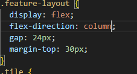|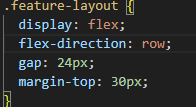 Se cambió la dirección del eje a row y a column para pantallas pequeñas en el mediaquery 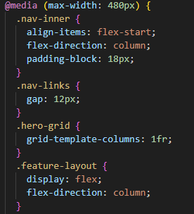|pantalla pequeña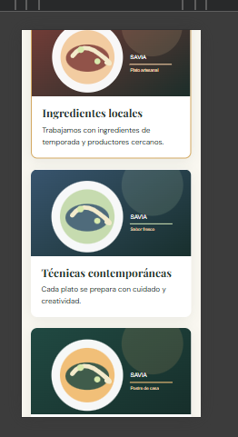 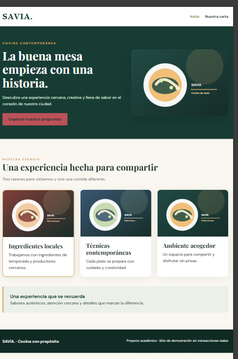 pantalla grande|Alexis Rivera |
| 2 |Al presionar el boton nuestra carta se abría la página eventos|La referencia href estaba incorrecta 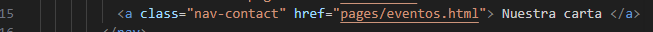|Se corrigió la referencia hacia el menu 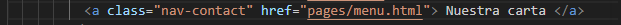 |redirige a menú 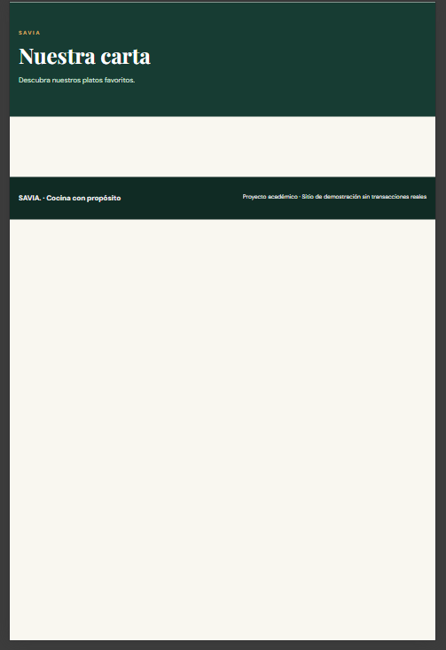 |Santiago |
| 3 |El botón explorar nuestra propuesta no tenía referencia a la página|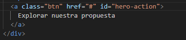 No hay referencia en href|Corrección agregando la referencia indicada 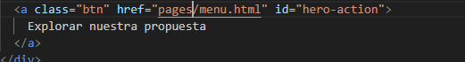|El botón ahora redirecciona a la página 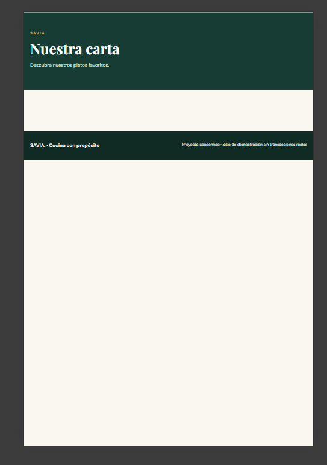|Alexis Rivera|
| 4 |El botón explorar nuestra propuesta es de color rojo|El color estipulado es rojo 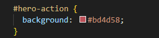|Se cambia el color a dorado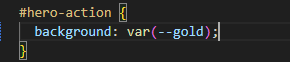 |botón color dorado 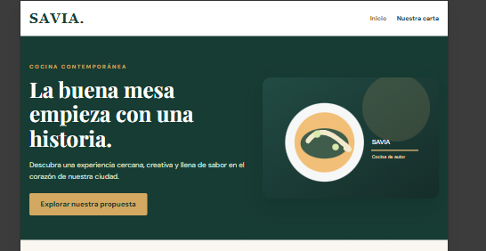| Santiago|
| 5 |el logo y la navegación en pantallas pequeñas se observa en acomodo row |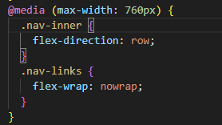 Esto debido a que el media query así lo indica para pantallas menores a 760px |La correción es poner la orientación a column en el media query 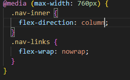|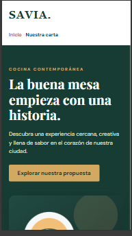 | Santiago y Alexis |

## Responsables de las funcionalidades

| Estudiante | Página asignada | Rama | Commits principales |
|---|---|---|---|
| | | | |

## Evidencias Git

| Funcionalidad/corrección | PR hacia develop | Revisor | Resultado de merge / conflicto si ocurrió |
|---|---|---|---|
| | | | |

## Verificación final
Registrar las pruebas de funcionamiento a 1280 px y 375 px, enlaces y páginas.
